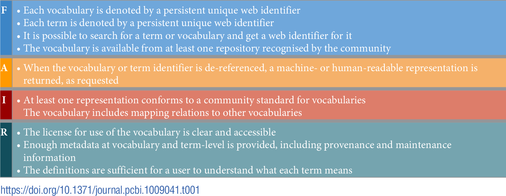
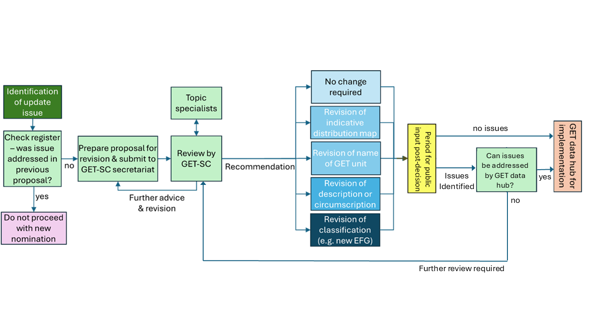

```{mermaid}
%%| fig-width: 6.5
%%| fig-align: center
%%| file: WP3.mmd
%%| fig-responsive: false
```

## Why do we need this? {.smaller}

- A controlled vocabulary provides a way to **organize knowledge** for subsequent retrieval.
- **A taxonomy is a type of controlled vocabulary** in which all the terms belong to a single hierarchical structure and have parent/child or broader/narrower relationships to other terms.
- **Users** may only apply terms from a restricted list, only **Editors** can make changes.
- Changes or additions to the list have to meet certain conditions and follow **review processes**.
- **Designing the metadata elements** for a digital asset collection and designing the controlled vocabulary are integrated processes.

@Harpring2010; @Hedden2010

## FAIR vocabularies



@Cox2021

## IUCN Global Ecosystem Typology

- A function-based typology for Earth’s ecosystems
- Hierarchical structure with six levels from Realms to Ecosystem types
- Global applications / multiple users
- Editors: groups of experts / IUCN GET Scientific Committee

## Ten simple rules for FAIR vocabularies {.smaller}

1. Determine governance / custodian
2. Verify license
3. Term and definition completeness/consistency
4. Traceable maintenancy-environment
5. Assign unique and persisten identifiers (PIDs)
6. Create machine readable representation
7. Add vocabulary metadata
8. Register the vocabulary
9. Make accessible for humans and machines
10. Process for revisions

@Cox2021

## Making it FAIR: Governance {.smaller}

The [Global Ecosystem Typology Scientific Committee (GET-SC)](https://red-list-ecosystem.github.io/GET-data-hub/governance.html) was established in 2024. 



## Making it FAIR: repos and identifiers

 [Repository](https://github.com/Ecosystem-Indicators-Workflows/IUCN-GET-vocabulary) with scripts to: 

- Export: Database -> tables -> rdf format
- Test API access

🆔 Permanent ID: [w3id.org/iucn-get](https://w3id.org/iucn-get/)

 Registered at [demo.vocabs.ardc.edu.au](https://demo.vocabs.ardc.edu.au/viewById/1167)


## Progress {.smaller}

1. Determine governance / custodian ✅
2. Verify license ✅
3. Term and definition completeness/consistency ✅
4. Traceable maintenancy-environment ✅
5. Assign unique and persisten identifiers (PIDs) ✅
6. Create machine readable representation ✅
7. Add vocabulary metadata 🚧👷🏽
8. Register the vocabulary ✅ (demo) ⏳ (production)
9. Make accessible for humans and machines 🚧👷🏽
10. Process for revisions ⏳

## Next steps

- Gayini Data Hub
- The DCCEEW vocabularies working group
- Global Ecosystem Atlas
- The IUCN SERIS project with MDAP / UniMelb 
- The [realm and biome task group](https://www.tdwg.org/community/dwc/realm-and-biome/) of the Darwin Core maintenance group 

## References

